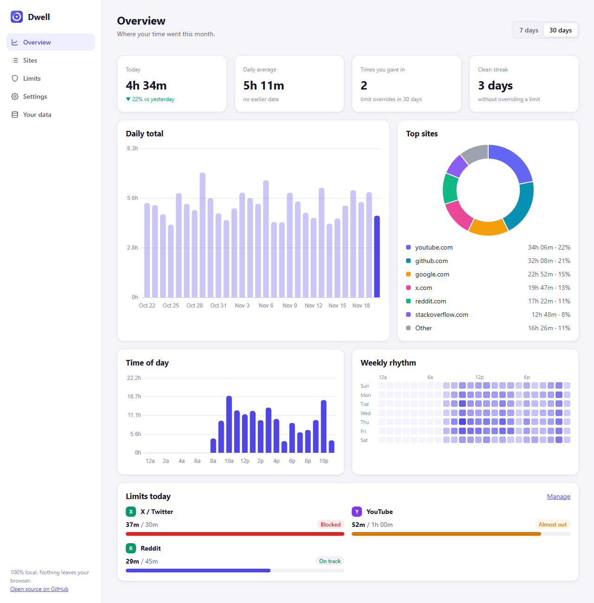
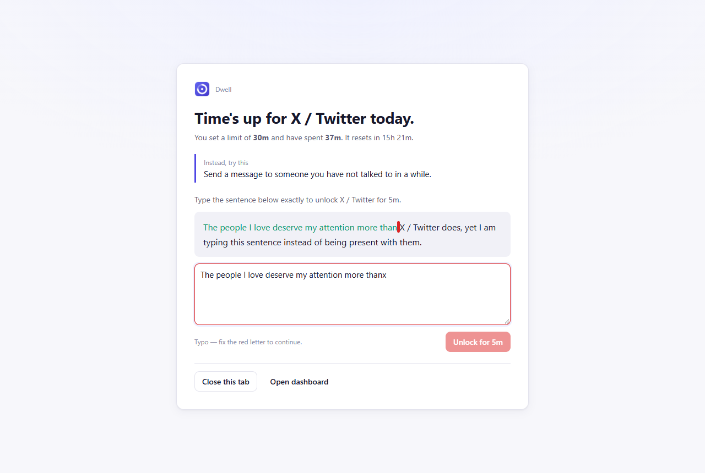
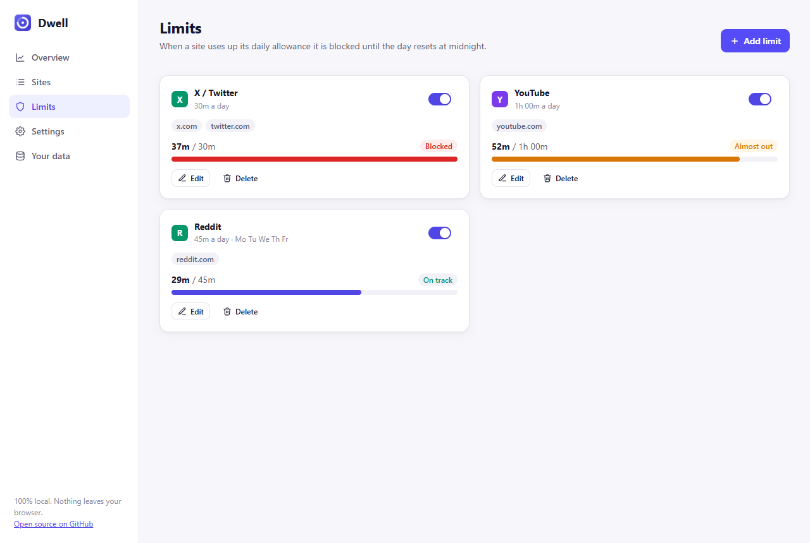
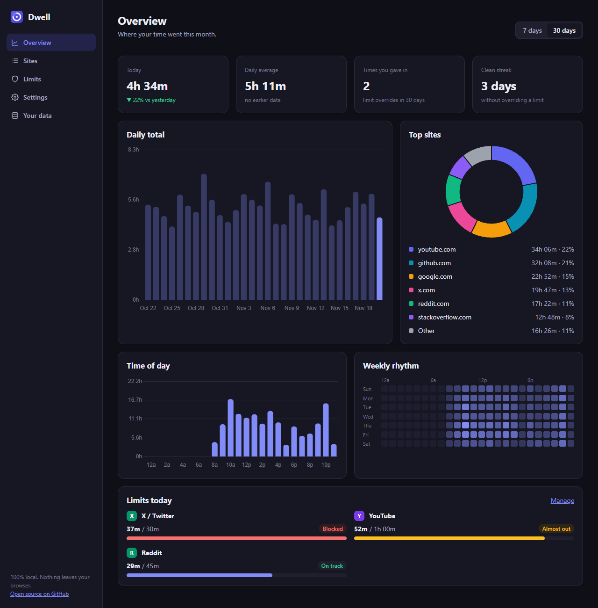
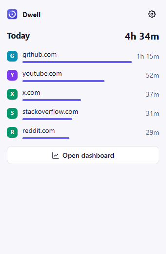

# Dwell

> Know where your time goes. Decide where it stays.

[](https://github.com/Arudchayan/dwell/actions/workflows/ci.yml)
[](LICENSE)

Dwell is a browser extension that measures how much active time you spend on each website, shows you where it goes, and lets you set daily limits per site or group of sites. All data stays in your browser.

Dwell runs in Chrome, Edge, and Brave (Manifest V3) and in Firefox 140 and later. It is built with WXT, TypeScript, Preact, and Chart.js.

## Features

- **Active time per website.** Time is counted only while the tab is active, its window is focused, and you are not idle (default idle threshold: 60 seconds). Domains are grouped by base domain, so `mobile.twitter.com` counts toward `twitter.com`.
- **Dashboard.** Today, week, and month totals, top sites, a time-of-day heatmap, and a "times you gave in" count.
- **Daily limits.** Set a limit for one site or a group of sites. For example, a "Twitter" group can cover `twitter.com` and `x.com` with a 1 hour per day limit. Limits can apply on selected weekdays only.
- **Warnings.** A notification when you reach 80% of a limit and again with 5 minutes left, plus a toolbar badge.
- **Block page with a guilt-trip unlock.** When a limit is reached, the site redirects to a block page. To override it, you must type a long sentence exactly. Pasting and dropping text is not allowed. An unlock grants a short grace period (default 5 minutes), and each further unlock that day requires a longer sentence.
- **Strict mode.** Turn off overrides entirely.
- **Configurable day reset.** Choose the hour your day resets (default: midnight).
- **Data control.** Export and import your data as JSON, export it as CSV, or delete all data with one button. Data is kept for 365 days by default, which you can change.

Dwell does not store browsing history or URLs. It keeps only the number of seconds spent per domain in each hour of the day.

## Screenshots



| Block page with the typing challenge             | Daily limits                           |
| ------------------------------------------------ | -------------------------------------- |
|       |  |
| **Dark mode**                                    | **Toolbar popup**                      |
|  |    |

_Screenshots use demo data. Regenerate them with `npm run screenshots`._

## Installation

### From a store

Store listings for the Chrome Web Store and Firefox Add-ons are coming soon.

### Chrome, Edge, or Brave (from GitHub Releases)

1. Download the Chromium `.zip` file from the [latest release](https://github.com/Arudchayan/dwell/releases/latest) and unzip it.
2. Open `chrome://extensions` (or `edge://extensions` or `brave://extensions`).
3. Turn on **Developer mode**.
4. Click **Load unpacked** and select the unzipped folder.

### Firefox 140 or later (from GitHub Releases)

1. Download the Firefox `.zip` file from the [latest release](https://github.com/Arudchayan/dwell/releases/latest) and unzip it.
2. Open `about:debugging#/runtime/this-firefox`.
3. Click **Load Temporary Add-on...** and select the `manifest.json` file in the unzipped folder.

Firefox removes temporary add-ons when it restarts, so you will need to load Dwell again after a restart.

## How limits and unlocks work

1. Create a limit for a site or a group of sites, with a daily duration and optional weekdays.
2. Dwell warns you at 80% of the limit and again with 5 minutes left.
3. When the limit is reached, visits to the site are redirected to the block page.
4. To continue, type the sentence shown on the block page exactly. Paste and drop are disabled. The unlock grants a short grace period (default 5 minutes).
5. Each further unlock on the same day requires a longer sentence.
6. Strict mode removes the option to unlock. Your day resets at the hour you configured (default: midnight).

## Privacy

Dwell is 100% local. It stores everything in `browser.storage.local` on your device. It makes no network requests, includes no analytics, loads no remote code, and has no accounts.

The full privacy policy, including a permissions table and instructions for deleting your data, is in [PRIVACY.md](PRIVACY.md).

## Development

Dwell requires Node.js 20 or later.

```sh
npm install
npm run dev
```

| Command                 | Purpose                                                   |
| ----------------------- | --------------------------------------------------------- |
| `npm install`           | Install dependencies (also runs `wxt prepare`)            |
| `npm run dev`           | Development build for Chrome with reload                  |
| `npm run dev:firefox`   | Development build for Firefox                             |
| `npm run build`         | Production build for Chrome (`.output/chrome-mv3`)        |
| `npm run build:firefox` | Production build for Firefox (`.output/firefox-mv3`)      |
| `npm run zip`           | Package the Chromium build as a `.zip`                    |
| `npm run zip:firefox`   | Package the Firefox build as a `.zip`                     |
| `npm run lint`          | Run ESLint and Prettier checks                            |
| `npm run lint:firefox`  | Build for Firefox and run `web-ext lint`                  |
| `npm run typecheck`     | Run TypeScript without emitting files                     |
| `npm test`              | Run unit tests with Vitest                                |
| `npm run test:coverage` | Run unit tests with coverage                              |
| `npm run test:e2e`      | Build the e2e target and run Playwright tests in Chromium |
| `npm run screenshots`   | Regenerate `docs/screenshots` from demo data              |

`npm run dev` opens a fresh browser profile with the extension loaded and reloads it on changes. To try a production build in your own browser, load `.output/chrome-mv3` (or `.output/firefox-mv3`) as described in [Installation](#installation).

### Testing

- **Unit and integration tests** (`npm test`) cover all pure logic in `src/core` (100% line coverage) plus the background engine, blocker and storage against a fake browser.
- **End-to-end tests** (`npm run test:e2e`) load the real extension into Chromium and drive it against local fake sites: tracking, blocking, the paste-proof challenge, grace periods and escalation, strict mode, day reset, the popup and the dashboard.
- **Firefox** is checked by `npm run lint:firefox` (`web-ext lint`) on every CI run. Playwright cannot load Firefox extensions, so before a release run `npm run dev:firefox` and check by hand: time is tracked, a 1-minute limit blocks the site, the sentence unlocks it, and the block returns after the grace period.

## Project structure

```text
src/
  core/          Pure logic: domain parsing, tracker, limits, sentences, stats, schema
  background/    Service worker wiring, blocker, notifications
  storage/       Typed storage layer over browser.storage.local
  entrypoints/   Popup, dashboard/options, blocked page, background entry point
  ui/            Shared Preact components
tests/
  unit/          Vitest unit tests
  e2e/           Playwright end-to-end tests (Chromium)
```

## Roadmap

These features are not part of v1 and are planned for later:

- Sync across devices
- Safari support
- Mobile support
- Per-URL-path limits (for example, `youtube.com/shorts`)
- Focus sessions (Pomodoro)
- Password-protected settings
- In-page warning banner

## Contributing

Contributions are welcome. Please read [CONTRIBUTING.md](CONTRIBUTING.md) before opening a pull request, and follow the [Code of Conduct](CODE_OF_CONDUCT.md). To report a security issue, see [SECURITY.md](SECURITY.md).

## License

Dwell is released under the [MIT License](LICENSE). Copyright (c) 2026 Arudchayan.
